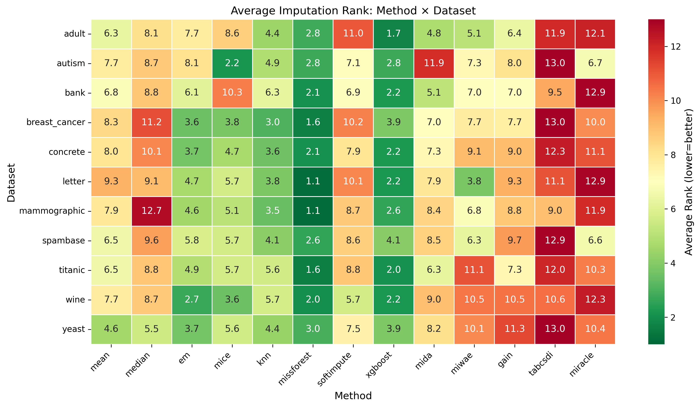
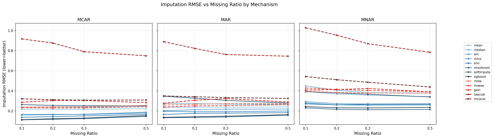
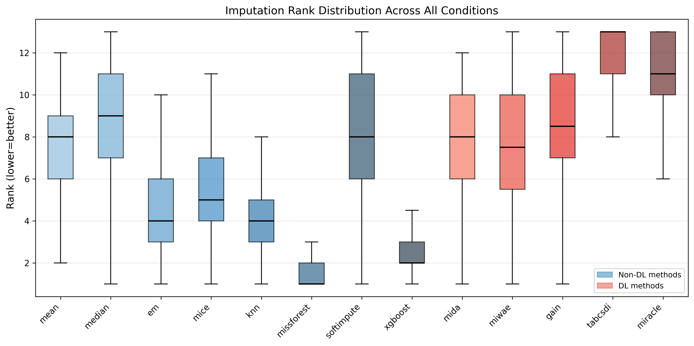
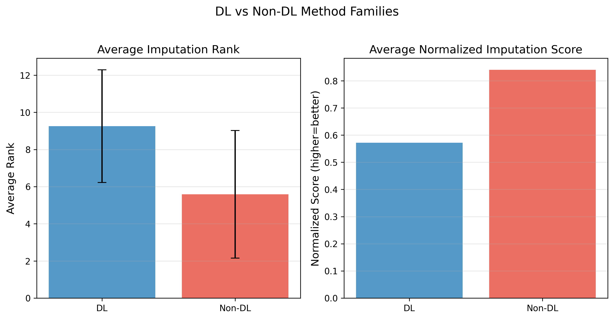
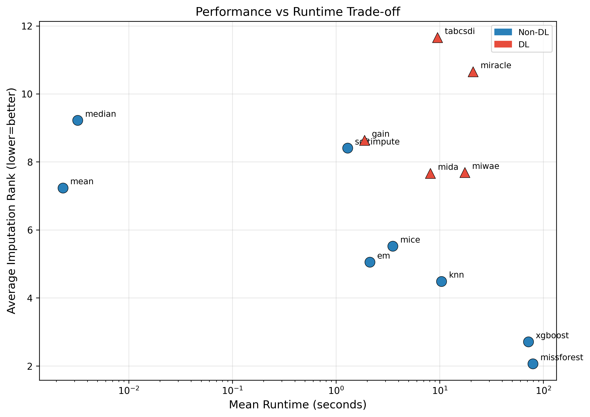
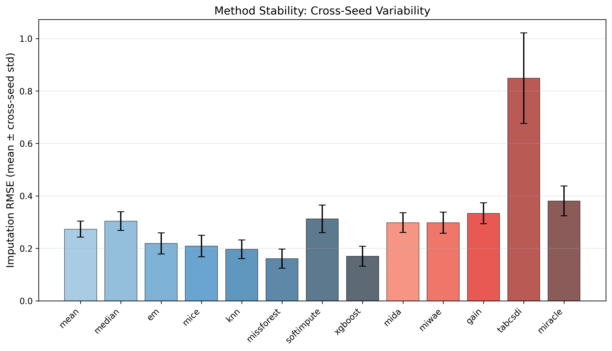
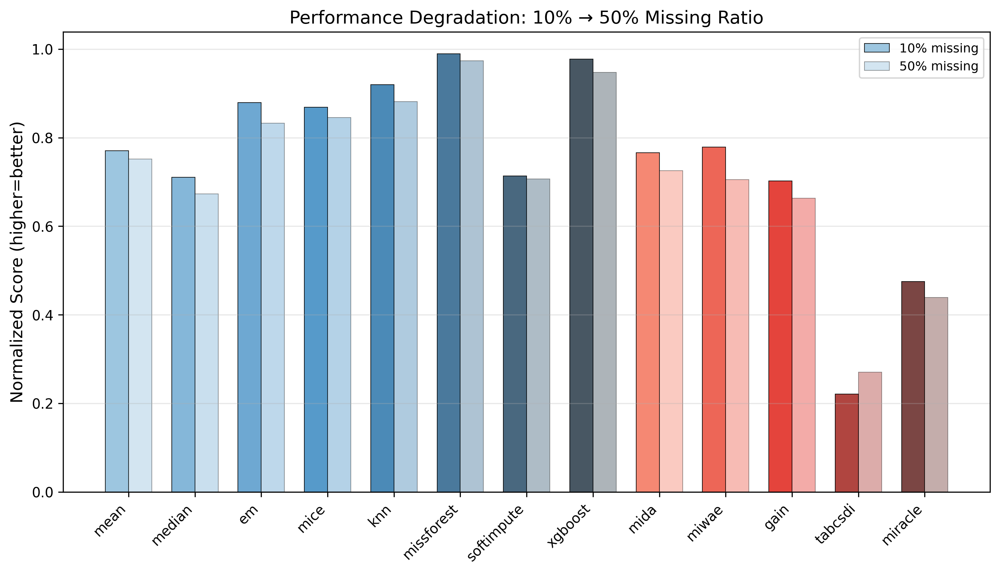
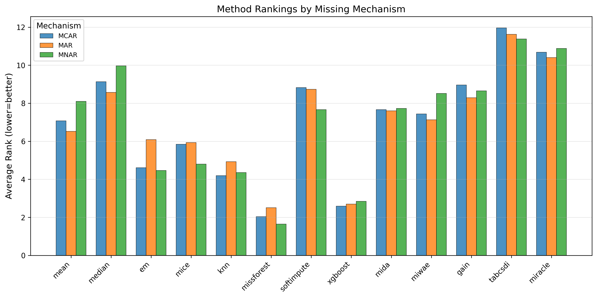
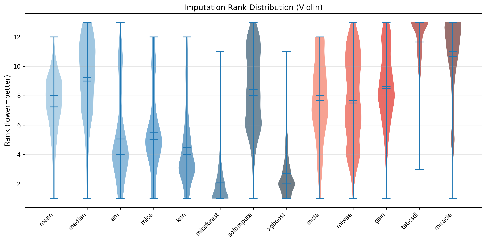
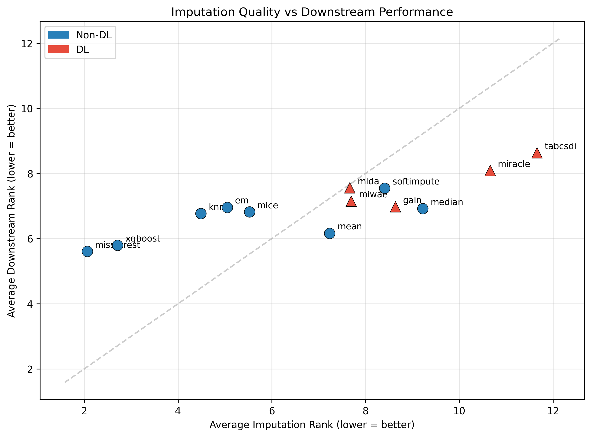

# Benchmark Results

Pre-computed results from a comprehensive missing value imputation benchmark:
**13 methods × 11 datasets × 3 mechanisms × 2 patterns × 4 rates × 5 seeds = 17,160 runs**.

## How to Use These Results

### Quick: Load the leaderboard

```python
import pandas as pd

# Overall method ranking
leaderboard = pd.read_csv("benchmark/leaderboard.csv")
print(leaderboard[["method", "family", "imp_avg_rank", "runtime_mean"]])
```

### Full: Load all 17,160 experiment results

```python
df = pd.read_csv("benchmark/full_results.csv")
print(f"Total runs: {len(df)}")
print(df.columns.tolist())

# Filter to a specific scenario
subset = df[(df["dataset"] == "adult") & (df["mechanism"] == "MCAR") & (df["ratio"] == 0.3)]
```

### LaTeX tables for your paper

All tables are available in both CSV and LaTeX formats in `tables/`:

| Table | Description | File |
|-------|-------------|------|
| Table 1 | Overall method ranking | `table1_overall_summary` |
| Table 2 | Best method per dataset | `table2_dataset_best_method` |
| Table 3 | Performance by missingness mechanism | `table3_mechanism_comparison` |
| Table 4 | Performance by missing rate | `table4_ratio_comparison` |
| Table 5 | Deep Learning vs Non-DL comparison | `table5_dl_vs_nondl` |
| Table 6 | Top-3 methods per condition | `table6_top3_methods` |
| Table 7 | Stability ranking (rank std) | `table7_stability_ranking` |
| Table 8 | Runtime efficiency | `table8_runtime_efficiency` |

## Figures

| Figure | Description |
|--------|-------------|
|  | **Fig 1.** Method × Dataset rank heatmap |
|  | **Fig 2.** Performance degradation by missing rate |
|  | **Fig 3.** Rank distribution (boxplot) |
|  | **Fig 4.** DL vs Non-DL comparison |
|  | **Fig 6.** Performance vs Runtime trade-off |
|  | **Fig 7.** Stability analysis |
|  | **Fig 8.** Degradation under high missing rates |
|  | **Fig 9.** Mechanism comparison (MCAR/MAR/MNAR) |
|  | **Fig 10.** Violin rank distribution |
|  | **Fig 11.** Imputation quality vs Downstream performance |

## Experimental Setup

- **Imputation quality metrics**: RMSE, MAE (numerical); Accuracy, Macro-F1 (categorical)
- **Downstream model**: RandomForest (n_estimators=100) — classification or regression depending on dataset
- **Ranking method**: Within-condition ranking (per dataset × mechanism × pattern × rate × seed), averaged across all conditions
- **Statistical tests**: Friedman test + pairwise Wilcoxon signed-rank with Holm correction
- **Hardware**: MacBook Pro M4 Pro, 48 GB RAM (CPU for all methods; MPS available for DL)

## Regenerate Results

To reproduce these results from scratch:

```bash
# 1. Run benchmark experiments
python scripts/run_batch.py --config configs/experiments/full_benchmark_nondl.yaml --no-wandb --workers 8
python scripts/run_batch.py --config configs/experiments/full_benchmark_dl.yaml --no-wandb --workers 2

# 2. Run analysis pipeline
python analysis/scripts/run_all.py
```

> Full benchmark takes ~24 hours on Apple M4 Pro. Results are deterministic given the same seeds.
